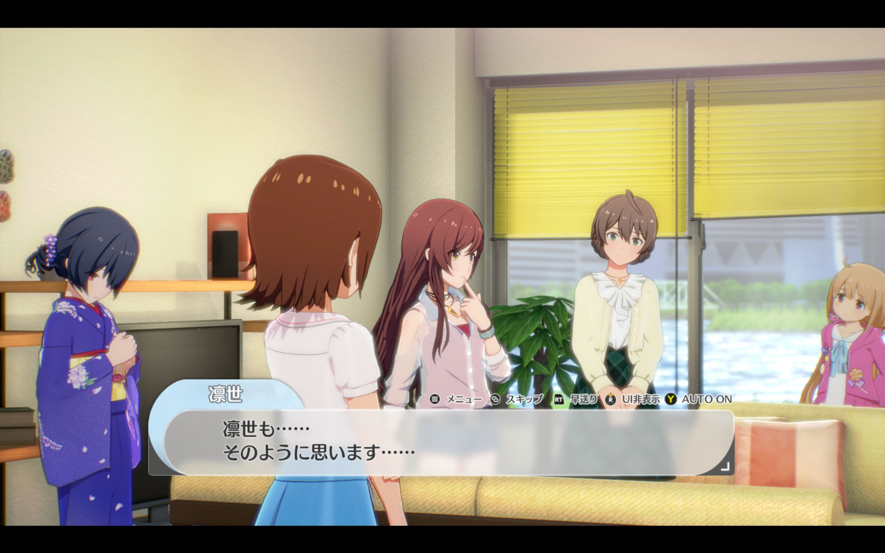
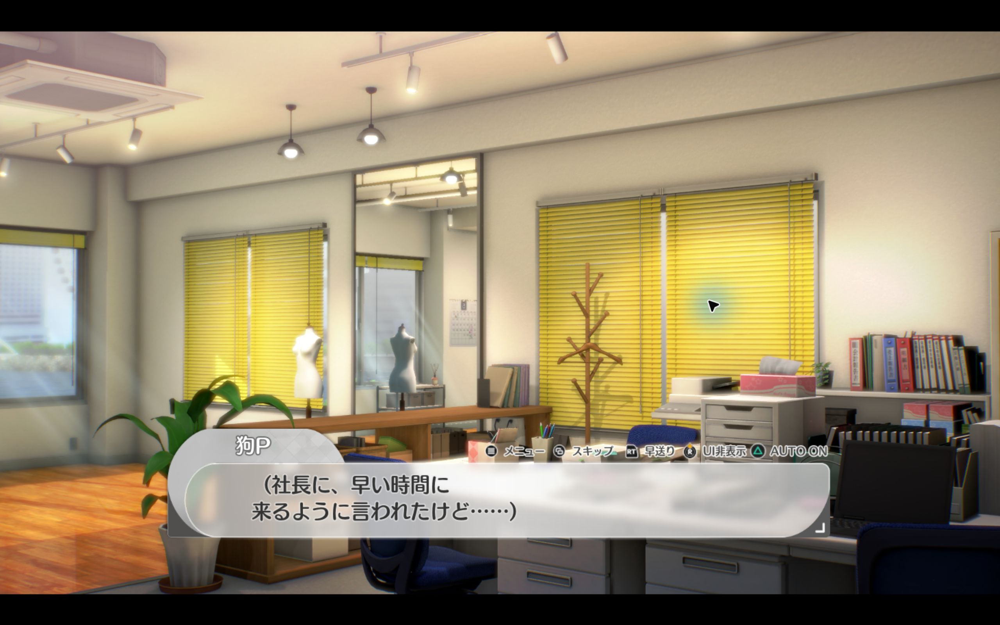

# 星耀季节：对话自动切换

在对话中一键切换自动播放和手动阅读，状态直接显示在游戏原有的按键提示栏里。

适用于 **Windows / Steam 版 v1.61**。

## 安装

1. **关闭游戏**，点击本页 **Code → Download ZIP**，下载并解压。
2. 打开解压后含有 `README.md` 和 `scripts` 的文件夹，在文件夹地址栏输入 `powershell`，按回车。
3. 粘贴下面这条命令并回车，把引号里的路径换成你的游戏目录：

   ```powershell
   powershell -NoProfile -ExecutionPolicy Bypass -File .\scripts\Install.ps1 -GameDirectory 'D:\Program Files (x86)\Steam\steamapps\common\StarlitSeason'
   ```

   找不到游戏目录？在 Steam 中右键游戏 → **管理 → 浏览本地文件**，复制打开的文件夹路径。

4. 等待安装完成，再从 **Steam** 启动游戏。所需文件会自动下载，无需另外安装加载器。

更新时，下载新版并重复以上步骤即可。

## 怎么用

进入对话后，按以下任意一个键切换：

| 使用设备 | 切换按键 |
| --- | --- |
| Xbox 手柄 | **Y** |
| Sony 手柄 | **△** |
| 键盘 | **A** |

- **AUTO ON**：台词自动推进。
- **AUTO OFF**：台词显示完后停住，按游戏原本的确认键继续。

每次启动默认开启自动。Sony 图标已验证显示，Sony 手柄真机仍未测试。

## 效果

手动阅读时，原生提示栏显示 **Y AUTO OFF**：


<details>
<summary>查看自动模式和 Sony 图标</summary>

自动模式：



Sony △ 图标（显示验证截图，未连接 Sony 手柄）：



</details>

## 停用

关闭游戏，在解压后的文件夹中打开 PowerShell，运行下面的命令，同样替换游戏目录：

```powershell
powershell -NoProfile -ExecutionPolicy Bypass -File .\scripts\Disable.ps1 -GameDirectory 'D:\Program Files (x86)\Steam\steamapps\common\StarlitSeason'
```

下次启动游戏即可恢复原本的对话行为。

安装报错、手柄图标设置及技术说明见 [详细说明](docs/development.md#安装与维护)。

---

模组采用 [MIT 许可](LICENSE)，使用 [UE4SS](https://github.com/UE4SS-RE/RE-UE4SS) 加载。截图中的游戏画面版权归游戏权利人所有。
